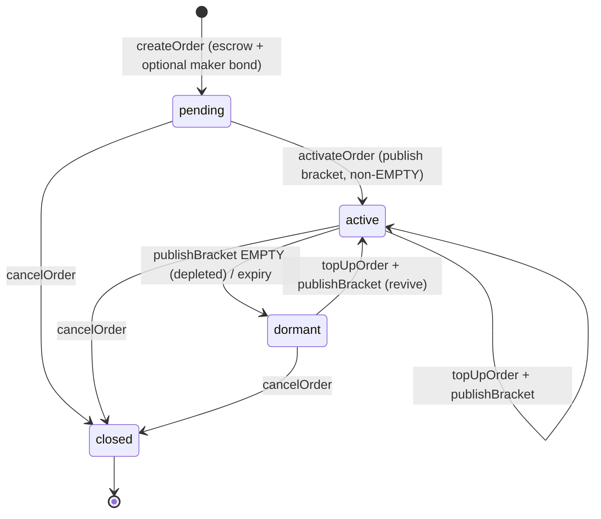

# Confidential OTC — Reference (Source of Truth)

The canonical, high-level technical reference for the **Confidential OTC**
(`ConfidentialOTC.sol`). It describes what the system does, who uses it, how the
pieces fit together, and the guarantees it makes. The oracle price model is
detailed in the companion doc:

- [`ORACLE.md`](./ORACLE.md) — the oracle price model, Q44.20 fixed-point, and
  the token whitelist. *(not yet vendored into this repo)*

> **Status note.** This document reflects the current contract. The older
> `README.md` and `CLEANUP_FEE.md` describe the superseded _fUSD cleanup-fee /
> `cleanupOrder`_ model and are retained only for history — prefer this file.

---

## 1. What it is

A peer-to-peer, on-chain OTC venue for **confidential** FHERC20 tokens on Fhenix
CoFHE. Any two whitelisted tokens can be traded against each other
(`cANY<>cANY`). **Order sizes and per-fill amounts stay fully encrypted**; the
only public size signal is a coarse **bracket** (NANO … WHALE) that the contract
computes under FHE and reveals as a plaintext `uint8`.

The defining design choice: the bracket is **plaintext on-chain**, so the order
book can be browsed, sorted, and filtered with **zero client-side decryption**,
and the contract itself can branch on order size (e.g. self-evict a depleted
order). Freshness of that public bracket is enforced economically (see §6).

### Design goals

| Goal                              | How it's met                                                                     |
| --------------------------------- | -------------------------------------------------------------------------------- |
| Confidential balances & fills     | All amounts are `euint64` handles; only the maker/taker can decrypt their own.   |
| Browsable book without decryption | Bracket stored as plaintext `uint8`, published via a threshold-decryption proof. |
| No maker self-reporting of size   | Bracket is computed from the _real_ encrypted value via FHE comparisons.         |
| No free fills / drains            | Input released only on full, non-zero payment (FHERC20 all-or-nothing).          |
| Fresh public state                | Mandatory, ETH-bonded post-fill publish; front-running-resistant.                |
| Permissionless cleanup            | Depletion self-evicts via the frontier rule; no paid cleaner role.               |

---

## 2. Roles & actors

| Role                   | Who                           | Capabilities                                                                         |
| ---------------------- | ----------------------------- | ------------------------------------------------------------------------------------ |
| **Maker**              | Liquidity provider            | `createOrder`, `activateOrder`, `topUpOrder`, `cancelOrder`.                         |
| **Taker**              | Filler                        | `fillOrder`, `publishBracket` (their fill record).                                   |
| **Publisher / keeper** | Anyone (bot)                  | `publishBracket` after the grace window, for a bounty.                               |
| **Oracle**             | Designated address (or owner) | `updateOraclePrice`, `setEthOraclePrice`.                                            |
| **Owner (admin)**      | `Ownable` owner               | `whitelistToken`, `delistToken`, `setOracle`, `setParams`, all oracle calls.         |
| **Indexer / frontend** | Read-only                     | `getOrder(s)`, `getOrdersByPair`, `getMakerOrderIds`, `getTakerFills`, `getPublish`. |

---

## 3. User stories

Grouped by role; each maps directly to contract behavior.

### Maker

- **Post an order.** As a maker, I want to escrow an encrypted amount of one
  whitelisted token and offer it for another at a fixed price, so I can sell
  confidentially. → `createOrder`
- **Reveal my size tier.** As a maker, I want my order to show a public bracket
  and become discoverable, without leaking the exact amount, so takers can find
  it. → `activateOrder` (first bracket publish; lists the order)
- **Grow a live order.** As a maker, I want to add more tokens to an existing
  order so I can deepen it without re-creating, and have its bracket update. →
  `topUpOrder` + `publishBracket`
- **Revive a depleted order.** As a maker, I want a fully-filled (dormant) order
  to come back to life when I top it up, instead of being permanently dead. →
  `topUpOrder` re-lists via the frontier rule
- **Track my fill progress privately.** As a maker, I want to see how much of my
  order has filled without anyone else learning it. → decrypt `remainingHandle`
  ÷ `depositedHandle` (maker-only ACL)
- **Exit anytime.** As a maker, I want to cancel and reclaim my remaining escrow
  (and my bond, if any) at any point. → `cancelOrder`

### Taker

- **Browse & sort without decrypting.** As a taker, I want to scan the book by
  pair and size tier instantly, so I can find a counterparty. → `getOrdersByPair`
    - plaintext `bracket`
- **Fill an order atomically.** As a taker, I want to pay and receive in one
  transaction, with no escrow window on my side and no risk of paying without
  receiving. → `fillOrder` (all-or-nothing release)
- **Fill only what I can afford.** As a taker, I want an over-sized request to be
  safely capped to the order's remaining size and my balance. → FHE `min` cap +
  `paidInFull` gate
- **Keep the book honest and get my bond back.** As a taker, I want to publish
  the post-fill bracket and recover my bond. → `publishBracket` (in-window, full
  refund)
- **Not be punished for slow threshold decryption.** As a taker, if I publish
  late, I want to lose at most a small bounty, never my principal. → post-window
  passive refund (§6)
- **Recover a superseded bond.** As a taker, if a later fill already superseded
  my record, I still publish it to settle and get my bond back; the proof is moot
  (it never moves the canonical bracket) but the bond returns in full when I
  publish within my window. → `publishBracket`

### Publisher / keeper (bot)

- **Earn for keeping the book fresh.** As a keeper, I want to publish abandoned
  post-fill brackets after the window and collect a bounty, so stale orders get
  corrected. → `publishBracket` after `windowSeconds` on the live frontier
  (bounty = `bountyBps`; non-frontier/closed publishes pay no bounty)

### Oracle

- **Keep bracket math accurate.** As the oracle, I want to update token prices
  and the ETH/USD price used for bonds. → `updateOraclePrice`, `setEthOraclePrice`

### Owner / admin

- **Curate tradable tokens.** As the owner, I want to add/remove tokens so only
  vetted assets trade. → `whitelistToken`, `delistToken`
- **Tune economics post-launch.** As the owner, I want to adjust bond sizes,
  bounty, and window without redeploying. → `setParams`
- **Delegate pricing.** As the owner, I want to appoint an oracle address. →
  `setOracle`

### Indexer / frontend

- **Render the book cheaply.** As the frontend, I want directional pair lists and
  batch hydration so I can paginate without per-order decryption. →
  `getOrdersByPair`, `getOrdersBatch`
- **Show pending-fill freshness.** As the frontend, I want to detect an
  unpublished frontier (`latestSeq > publishedSeq`) and flag the bracket as
  "maybe changing." → compare `latestSeq` / `publishedSeq`; offer manual decrypt
  of `bracketHandle`

---

## 4. Glossary

| Term               | Meaning                                                                                                                                           |
| ------------------ | ------------------------------------------------------------------------------------------------------------------------------------------------- |
| **Bracket**        | Coarse size tier (0–5) of the order's remaining USD-equivalent value. `255` = unpublished.                                                        |
| **USD**            | The bracket and bond unit of account: an abstract 6-decimal unit, not a token. Every whitelisted token, stablecoins included, is oracle-priced in it. |
| **Q44.20**         | Fixed-point format: value × `2^20`. Used for oracle prices and the fee.                                                                            |
| **seq**            | Monotonic per-order sequence number; one per state-changing action (create/fill/top-up).                                                          |
| **Publish record** | An immutable bracket snapshot for a given `seq`, plus its bond metadata.                                                                          |
| **Frontier**       | The latest record (`seq == latestSeq`); only its publish changes listing.                                                                         |
| **publishedSeq**   | Highest seq whose bracket is canonical (drives the displayed `bracket`).                                                                          |
| **Absorption**     | A record is absorbed once `publishedSeq` passes its seq; its bracket is moot but its depositor still publishes it to settle and recover the bond. |
| **Dormant**        | Was active, now delisted (depleted/expired), escrow retained, revivable by top-up.                                                                |
| **Closed**         | Cancelled; terminal.                                                                                                                              |
| **Fill bond**      | ETH posted by a taker at `fillOrder`, recovered by publishing the post-fill bracket.                                                              |
| **Maker bond**     | Optional anti-spam ETH at `createOrder` (`makerBondUsd`, default 0), returned on cancel.                                                          |
| **Window**         | Depositor-exclusive grace period after a fill during which only the depositor may publish.                                                        |
| **Bounty**         | Share of an abandoned fill bond paid to whoever publishes after the window.                                                                       |

---

## 5. Order lifecycle



- **pending** — created; input (and optional maker bond) escrowed; bracket not
  revealed; not discoverable or fillable.
- **active** — bracket published non-EMPTY; listed in the pair index; fillable
  and top-up-able.
- **dormant** — was active, frontier bracket is EMPTY (depleted) or order expired;
  delisted but **not destroyed** — escrow retained, revivable by `topUpOrder`.
- **closed** — cancelled by the maker; terminal. Escrow + maker bond returned;
  outstanding fill bonds remain recoverable by their depositors.

### Two-step actions

Every action that changes `eRemaining` is **tx1 (value) + tx2 (bracket reveal)**:

```
createOrder  → (threshold decrypt) → activateOrder         # seq 1
fillOrder    → (threshold decrypt) → publishBracket(seq)   # taker, bonded
topUpOrder   → (threshold decrypt) → publishBracket(seq)   # maker, bondless
```

Value always settles atomically in tx1; tx2 only reveals the bracket and, via the
**frontier rule**, lists or delists the order.

---

## 6. Bonds, window & bounty (freshness economics)

A stale public bracket is a UX failure (a taker sees `LARGE`, fills, finds a
tenth of that). So the **post-fill publish is mandatory and bonded**:

| Phase                                                                               | Who may publish a fill record | Bond settlement                                  |
| ----------------------------------------------------------------------------------- | ----------------------------- | ------------------------------------------------ |
| Within `windowSeconds` of the fill                                                  | only the depositor (taker)    | 100% refunded                                    |
| After `windowSeconds`, record is the live frontier (`seq == latestSeq`, open order) | anyone                        | `bountyBps` to publisher, remainder to depositor |
| After `windowSeconds`, record is non-frontier (absorbed) or order is closed         | anyone                        | 100% refunded to depositor (no bounty)           |

- **Front-running defense.** Inside the window only the depositor can publish, so
  a bot copying the proof from the mempool reverts (`NotInWindow`). After the
  window the depositor is refunded **passively**, so an honest-but-late depositor
  has nothing in the mempool to steal — bots only compete over genuinely
  abandoned bonds.
- **Bounty is frontier-scoped.** A bounty is paid only for an out-of-window
  publish of the current frontier on an open order — the only publish that keeps
  the displayed bracket fresh. Publishing an absorbed (superseded) record, or any
  publish on a closed order, refunds the depositor in full and pays the keeper
  nothing, so there is no moot record to publish for a skim. Absorbed bonds are
  recovered by their own depositor.
- **Maker publishes are bondless.** `activateOrder` / `topUpOrder` are
  self-incentivized: skipping them only hurts the maker's own order (it stays
  pending/dormant, or under-reports its size, which is favorable to the order).
- **Bond sizing.** USD-denominated, priced into wei via the ETH oracle.
  `ethBondSize()` / `makerBondSize()` return the instantaneous wei; `msg.value`
  must cover it and any excess is refunded.

### Governable parameters (`setParams`)

| Parameter        | Default          | Notes                                                  |
| ---------------- | ---------------- | ------------------------------------------------------ |
| `fillBondUsd`    | `5_000_000` ($5) | Taker fill bond.                                       |
| `makerBondUsd`   | `0`              | Optional anti-spam lever; off by default.              |
| `bountyBps`      | `2_000` (20%)    | Post-window publisher reward.                          |
| `windowSeconds`  | `600` (10 min)   | Depositor-exclusive window.                            |
| `ethOraclePrice` | unset            | Q44.20 USD/ETH; **must be set before bonded actions**. |

---

## 7. Seq, Publish records & the frontier rule

- Each order tracks `latestSeq` (bumped by every create/fill/top-up) and
  `publishedSeq` (highest canonical seq).
- A `publishBracket` advances the displayed `bracket` only when `seq >
publishedSeq`; older/out-of-order publishes are **swallowed** (they still settle
  their own bond).
- **Frontier rule:** only a publish for `seq == latestSeq` changes listing —
  non-EMPTY lists/re-lists, EMPTY delists. This makes depletion **self-evict** and
  top-ups **self-revive**, and prevents a stale EMPTY proof from delisting an
  order that has since been refilled.
- **Absorption:** once `publishedSeq` passes a record's seq, the record is
  superseded — its bracket no longer matters, but its depositor still publishes it
  to settle and recover the bond. The proof is verified but never advances the
  canonical bracket. On a busy order, only the frontier publish actually moves the
  displayed bracket.

Worked example — `fillA-1, fillB-1, fillB-2, fillA-2`: `fillB-2` sets canonical
and `publishedSeq = seqB`; `fillA-2` arrives last but `seqA < publishedSeq`, so it
is swallowed — it still settles `fillA`'s bond, it just doesn't change the bracket.

---

## 8. Pricing & brackets

### Price (Q64.64 in, mantissa + shift stored)

`createOrder` takes `priceX64`, a Q64.64 rate of **raw output units per raw input
unit** (× 2^64), and stores it rounded up as a 16-bit mantissa `price` with a
per-order binary point `priceShift` (rate = `price / 2^priceShift`). Output is
computed under FHE as `eOutput = (eActual × price + 2^priceShift − 1) >>
priceShift`, rounded up.

| Rate (6-decimal legs)         | `priceX64`           | stored          |
| ----------------------------- | -------------------- | --------------- |
| sell cBTC for cUSD at $84,000 | `84_000 << 64`       | `84_000 / 2^0`  |
| buy cBTC with cUSD at $84,000 | `(1 << 64) / 84_000` | `51_131 / 2^32` |
| $1.00                         | `1 << 64`            | `32_768 / 2^15` |

Per-fill input is capped (`_fillCap`) so `eActual × price` never wraps. The cap
counts **raw input units**: under 2^49 whenever `priceShift > 0`. That is ~$281M
of a $1 token per fill, but only a few $k of a $0.00001 token, so cheap inputs fill in
many pieces. Total order size across fills is unbounded.

`createOrder` reverts `PriceTooLow` for a rate so small (below 5,243 / 2^63 ≈
5.7e-16 raw output per raw input) that the
fee multiply at `MAX_SWAP_FEE_Q20` would need a tighter cap than the price one:
such a fill would buy less than one raw output unit yet pay a whole one. Checked
at the maximum fee, so raising the fee never changes an existing order's cap.

### Bracket tiers

| Bracket     | Value | USD-equivalent of remaining size |
| ----------- | ----- | -------------------------------- |
| EMPTY       | 0     | depleted or cancelled            |
| NANO        | 1     | < $100                           |
| SMALL       | 2     | $100 – $1,000                    |
| MEDIUM      | 3     | $1,000 – $10,000                 |
| LARGE       | 4     | $10,000 – $100,000               |
| WHALE       | 5     | ≥ $100,000                       |
| UNPUBLISHED | 255   | sentinel before first reveal     |

The USD-equivalent is always derived from the **input token's oracle price**,
never the maker's order price. Each USD bracket boundary is translated into the
token's raw units whenever its price is pushed, so the encrypted side is a plain
comparison.

---

## 9. Oracle & whitelist

- Only whitelisted tokens trade. Each carries a Q44.20 `oraclePrice` used **only**
  for bracket computation (never for fill math, which uses the order `price`).
- No token is auto-whitelisted and none is pinned at $1. A stablecoin is
  whitelisted at `Q_DENOM` ($1) like any other token, and its price ages (see
  `isPriceStale`) unless the oracle keeps pushing it. Tokens are capped at 6
  decimals; higher-decimal tokens can't be priced precisely in Q44.20.
- `ethOraclePrice` (Q44.20 USD/ETH) sizes ETH bonds.
- See [`ORACLE.md`](./ORACLE.md) for the full model and `MIN_ORACLE_PRICE`.

---

## 10. Operator prerequisites

CoFHE FHERC20 uses time-bound operators (not allowances). Before interacting:

- **Maker** (before `createOrder` / `topUpOrder`):
  `inputToken.setOperator(otc, until)`.
- **Taker** (before `fillOrder`): `outputToken.setOperator(otc, until)`.
- ETH for bonds is sent as `msg.value`; no token operator needed for bonds.

---

## 11. Read API (frontend integration)

`getOrder` / `getOrdersBatch` return an `OrderView`:

| Field                                                   | Notes                                                        |
| ------------------------------------------------------- | ------------------------------------------------------------ |
| `maker`, `inputToken`, `outputToken`, `price`, `expiry` | order terms                                                  |
| `bracket`                                               | **plaintext** size tier (0–5 / 255) — no decryption          |
| `latestSeq`, `publishedSeq`                             | freshness: `latestSeq > publishedSeq` ⇒ a pending publish    |
| `bracketHandle`                                         | frontier encrypted snapshot — optional manual verify-decrypt |
| `remainingHandle`, `depositedHandle`                    | encrypted balances — **maker-only** decrypt                  |
| `active`, `pending`, `closed`                           | lifecycle flags                                              |

Discovery / supporting reads:

- `getOrdersByPair(input, output)` → active ids for a **directional** pair
  (`(A, B)` = orders selling A for B; reverse for the other side).
- `getMakerOrderIds(maker)`, `getTakerFills(taker)`.
- `getPublish(orderId, seq)` → `(handle, depositor, bondWei, deadline, settled)`
  to know what to publish and whether a bond is recoverable.
- `ethBondSize()`, `makerBondSize()`, `getTokenConfig(token)`.

**Frontend freshness pattern:** if `latestSeq > publishedSeq`, show the bracket
with a "may be changing" marker and optionally decrypt `bracketHandle` for the
true current tier.

---

## 12. Events & errors

**Events:** `TokenWhitelisted`, `TokenDelisted`, `OraclePriceUpdated`,
`EthOraclePriceUpdated`, `ParamsUpdated`, `OrderCreated`, `OrderActivated`,
`OrderFilled`, `OrderToppedUp`, `OrderCancelled`, `BracketPublished`,
`OrderDelisted`.

> Indexers: key the book off `OrderActivated` (join) and `BracketPublished` /
> `OrderDelisted` / `OrderCancelled` (update/leave). `OrderFilled` /
> `OrderToppedUp` carry the `seq` that still needs a publish.

**Errors:** `ZeroAddress`, `SameLeg`, `ZeroPrice`, `PriceTooLow`, `InvalidDecimals`,
`InvalidExpiry`, `TokenNotWhitelisted`, `Unauthorized`, `OrderNotFound`,
`OrderNotActive`, `OrderClosed`, `OrderExpired`, `NotMaker`, `LengthMismatch`,
`EthOracleUnset`, `WrongBond`, `PublishNotFound`, `AlreadySettled`, `NotInWindow`,
`EthTransferFailed`.

---

## 13. Security properties & invariants

- **No free fills:** input released only on full, non-zero payment (`paidInFull`).
- **No silent overflow:** per-fill input capped by `_fillCap` so the price
  multiply cannot wrap, and `createOrder` rejects rates (`PriceTooLow`) whose cap
  the fee multiply at `MAX_SWAP_FEE_Q20` could wrap.
- **No maker self-reporting:** brackets derive from the real encrypted value.
- **Bracket monotonicity:** canonical bracket only advances on `seq >
publishedSeq`; listing changes only on the frontier.
- **Bond safety:** depositor principal is never at risk on the honest path; worst
  case for a late publish is the bounty, and only on the live frontier. Bonds
  settle exactly once (`settled`).
- **No bounty skim:** a bounty is paid only for an out-of-window frontier publish
  on an open order; absorbed/non-frontier/closed publishes refund in full, so a
  keeper cannot earn by publishing moot records.
- **Front-running resistance:** depositor-exclusive window + passive post-window
  refund (see §6).
- **Reentrancy:** all external state-mutating functions are `nonReentrant`;
  ETH is sent via `call` and reverts on failure.
- **Revivability:** delisting never destroys escrow; only `cancelOrder` is
  terminal and maker-only.
- **Persistent FHE ACL:** reused encrypted constants are `allowThis`'d in the
  constructor so they remain valid operands across transactions.

### Trust assumptions / threat model

- Both legs are **arbitrary and maker-chosen**; the owner whitelist is the
  curation gate. A taker granting operator rights on a maker-controlled token is
  exposed to that token's behavior — verify addresses.
- Bracket plaintext correctness relies on the **CoFHE threshold network**
  decryption + signature (`publishDecryptResult`).
- The **oracle** is trusted for bracket accuracy and bond sizing; it does not
  affect fill math, so a bad price misclassifies size but cannot mis-settle a swap.

---

## 14. Deployment & operations

- Deploy via the shared `@launch-platform/contracts-hardhat` package (not
  `npx hardhat`, which pulls Hardhat 3). `viaIR` is enabled.
- **Constructor:** `treasury` only. Post-deploy the owner must:
    1. `whitelistToken` each tradable token, including any stablecoin, with a
       sane Q44.20 price.
    2. `setEthOraclePrice` (required before any bonded fill).
    3. `setOracle` (optional) to delegate ongoing price updates.
    4. `setParams` to opt into a maker bond, retune the fill bond, etc.
- Bonds accrue ETH in the contract; it is fully accounted to depositors/makers and
  returned/bountied on settle — there is no owner sweep.

---

## 15. Known limitations & open questions

- **Expired orders linger** in the pair index until the maker cancels (expiry is
  public, so the frontend filters them trivially). No permissionless expiry
  eviction.
- **Per-fill size ceiling** of ~2^48 raw input units (64-bit multiply with a
  16-bit mantissa). Fine for a $1 token (~$281M) and BTC, but a trade in a very cheap
  input token (e.g. $0.00001) is capped at a few $k per fill and must be split,
  each fill paying its own gas and bond.
- **Clamped fills can overpay by one raw output unit.** A fill request above the
  order's remaining size (which only the maker can see) is clamped, and the
  taker's payment is rounded up to a whole raw unit of the output token. A fill
  clamped to a dust remainder therefore costs at least one raw output unit. At 6
  decimals that is cents; for a 0-decimal output token it is a whole coin. The
  maker can force it by draining their own order from a second address just
  before a taker's fill. Accepted: listing coarse-decimal tokens is an owner
  decision, and takers on such pairs carry this risk.
- **Oracle latency** can transiently misclassify a bracket between price updates.
- **Bracket granularity** is coarse by design (6 tiers); it is an indicator, not a
  precise size.

---

## 16. Recommended additions (maintenance checklist)

Candidates to extend this doc / surrounding docs as the system matures:

1. **Deployed addresses table** per network (with explorer links) once live.
2. **ABI / SDK snippets** — copy-paste `fillOrder` + `publishBracket` flows
   (encrypt → tx → decrypt → publish) for integrators.
3. **Gas & cost notes** per action (and the ~$ bounty break-even on the target L2).
4. **Sequence diagrams** for the bond settlement branches (in-window / late /
   absorbed / post-cancel recovery).
5. **Threat model appendix** — formal listing of attacker capabilities and
   mitigations (front-running, griefing, dust spam, malicious token leg).
6. **Audit log / changelog** — track parameter changes and contract upgrades.
7. **Reconcile/retire `README.md` and `CLEANUP_FEE.md`** so there is a single
   source of truth (this file).
8. **Frontend state machine** — how the UI maps `(active, pending, closed,
latestSeq vs publishedSeq, expiry)` to display states and CTAs.

```

```
